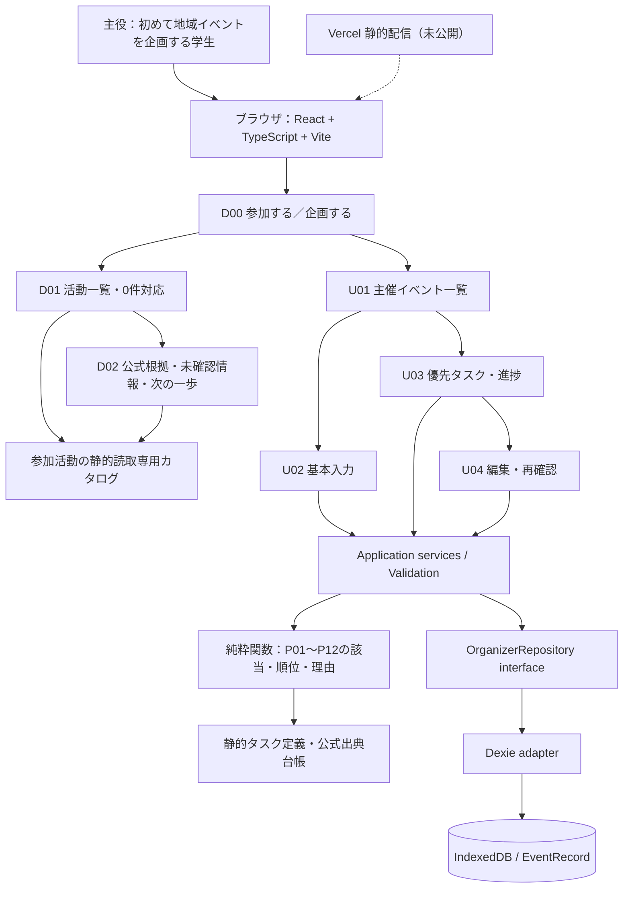

# 現行アーキテクチャ整理：二入口と一人の主役（2026-11-21）

**位置付け：設計図。** [従来のARCHITECTURE_V1](ARCHITECTURE_V1.md)は作成済みだが、主催中心の初期設計で、2026-11-18以降に正式採用した参加/企画二入口とチーム担当分担を十分に表していなかった。本書はその補足であり、[ADR-001](ADR_001_TECH_STACK_ADOPTED.md)、[ADR-030](ADR_030_TOYAMA_PARTICIPATE_AND_ORGANIZE_MVP_SCOPE_ADOPTED.md)、[ADR-031](ADR_031_PARENT_TASK_PROGRESS_ONLY_NO_CHILD_CHECKS_ADOPTED.md)、[ADR-032](ADR_032_TECHNICAL_V1_DATA_RECHECK_EQUIPMENT_AND_API_ADOPTED.md)が正本。技術の新規採用・コード実装ではない。

## 全体構成

**データの分離**：参加活動は閲覧専用の静的カタログ、主催イベントはローカルのEventRecord。参加履歴や掲載活動を主催イベントのJSONバックアップに混入させない。サーバーに利用者のイベント/進捗は保存しないMVP。個人のブラウザー間の同期も保証しない。

## 責務と実装順序
| 担当 | 初手の実装領域 | 他者との境界 |
|---|---|---|
| A #34 | D00/D01：参加の二入口と活動0件表示 | 実在活動の承認はE。主催保存型を編集しない |
| B #36 | U02：主催者の基本6問入力。後続でルール純粋関数 | CのU03進捗保存を勝手に実装しない |
| C #38 | U03：親タスク12件の進捗・要再確認 | Dの保存APIと共通型を使う |
| D #40→#41→#42 | 共通型、Repository/Dexie、JSONバックアップ | revision競合CAS・既定のAPI契約を提供 |
| E #45/#55 | ADR、出典、統合レビュー、応募資料 | UI/型/ルールの食い違いを調整 |

**最優先の依存関係**：Dの共通型・RepositoryのインターフェースをB/Cと早期に共有。Aは独立した活動0件UIを進められる。B/Cが同時にU03の同じファイルを大改修しない。各人の担当ブランチとPRで実装。

## 主催側の代表的処理
1. U02初回下書きはReactメモリ内に保持。保存が成功するまでU03に「保存済み」として移らない。
2. Validationで未回答・未定・回答済み、日付・人数・文字数/版を厳密に扱う。
3. Rule engineは入力と読取専用公式出典からP01〜P12の該当・P1/P2/P3・理由を算出。**優先順位は原則DBへ固定保存しない**。P05/P08・限定P2・同順位taskId順は既決のADRを優先。
4. U03進捗変更はexpectedRevisionを用いたCAS保存。statusとneedsRecheckを別々に扱い、子チェックを追加しない。
5. U04編集は保存済みレコードとは別のドラフト。保存失敗・競合は成功表示しない。変更に関係する親のみ要再確認。
6. JSONバックアップは本人選択・上限100件/2MiB・unknown版拒否・確認後の原子的取込、既存レコードの無断上書きなし。

## 機能境界と未決
- `src/features/discovery`、`src/features/organizer`、`src/domain`、`src/application`、`src/infrastructure` は**提案フォルダ名**。現行の雛形にこれらが実在するとは扱わない。
- ルーター、UIライブラリ、テストランナーはこの図で新規採用しない。初回実装PRで既存設計と衝突しない最小構成を判断する。
- Vercelは選定済みだが**デプロイ/CI/公開は行わない**。
- EのPCでNode v26の共通Vite仮画面についてdoctor/typecheck/build/dev・ブラウザー表示のみ成功。**7画面、保存・判定・バックアップは未実装/未検証**。

## デモと結びつける
[一人の主役](PRIMARY_PERSONA_AND_SUCCESS_SCENARIO_20261121.md)による「企画したい→条件入力→理由付きの最初の一歩→進捗・修正」を説明の背骨にし、参加D00/D01/D02は二入口の補助として示す。
