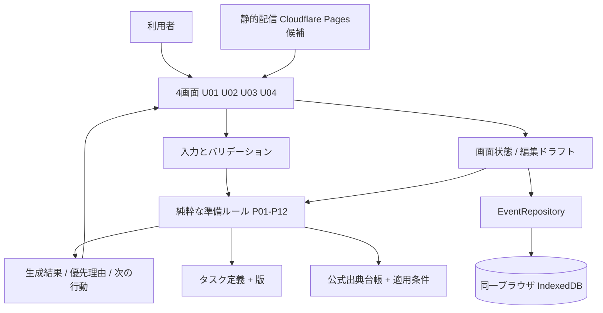

> **2026-11-15追記：本書は以前の統合草案です。** 採用技術に沿う現行設計は[ARCHITECTURE_V1.md](ARCHITECTURE_V1.md)と[DATA_DESIGN_V1.md](DATA_DESIGN_V1.md)。正式技術決定は[ADR-001](ADR_001_TECH_STACK_ADOPTED.md)。

# アーキテクチャ・データ設計 v1（推奨案／2026-11-15）

> **未採用の構成案・未実装**。[技術選定提案](TECH_SELECTION_V1_PROPOSAL.md)に基づく。最終技術の承認後に「確定版」へ更新する。対象は単発・小規模の非営利地域イベント開催準備支援Webアプリ。**旧空き家所有者・物件・マッチング・用途診断のデータは使用せず、移行対象にも含めない。**

## 1. 全体構成



- 静的配信はアプリ資産（JS/CSS/HTML）と、採用するタスク定義・公式出典台帳を公開する。イベント条件や進捗はサーバーへ送信しない設計。
- イベント情報・タスク定義・タスク進捗・生成結果を分離。ランキングは保存情報から再計算。ネット接続が切れた時のサイト利用可否は配信キャッシュ構成に依存するためオフライン保証なし。
- ローカル保存の具体APIは正式技術選定後に確定。

## 2. 論理レイヤ

| レイヤ | 責任 | 禁止 |
|---|---|---|
| UIコンポーネント | 画面/選択/エラー/保存状態/アクセシビリティ | 独自の施設条件や優先度計算を埋め込まない |
| Validation | 基本6問、任意入力、未定・未回答・値を型として検証 | 未回答を「なし」に変えない |
| Rule engine | 該当判定、優先、依存、再確認、理由の導出 | ブラウザDBアクセス、ネット送信、機械学習による許可断定 |
| Catalog/Sources | P01-P12安定ID、確認項目、公式情報の版・URL・確認日 | 別施設への規則の自動適用 |
| Repository | 複数イベントの保存、削除、更新番号、移行 | 旧revisionの無条件上書き |
| Application service | 読み込み→検証→ルール計算→保存→画面反映の順序制御 | 保存前の「保存済み」表示 |

## 3. データエンティティ案（TypeScript相当）

```ts
type Answer<T> =
  | {kind: "unanswered"}
  | {kind: "undecided"}
  | {kind: "answered"; value: T};

type ProgressStatus = "not_started" | "in_progress" | "completed" | "not_applicable";

interface EventRecord {
  eventId: string;             // UUID等、別イベントと衝突しないID
  schemaVersion: number;
  rulesVersionAtLastReview: string;
  revision: number;            // 同一eventIdの保存成功ごとに増加
  createdAt: string;
  updatedAt: string;
  input: EventInput;
  progressByTask: Record<string, TaskProgress>;
}
interface EventInput {
  eventType: "workshop" | "lecture" | "exchange" | "other";
  audience: "minors" | "adults" | "both" | "undecided";
  schedule: {kind:"date";value:string} | {kind:"month";value:string} | {kind:"undecided"};
  venueStatus: "undecided" | "candidate" | "confirmed" | "no_physical_venue";
  region: "takaoka" | "toyama_other" | "outside_toyama" | "undecided";
  organizerForm: "solo" | "group" | "undecided";
  attendees?: Answer<number>;
  responsible?: Answer<"decided" | "not_decided" | "unknown">;
  equipment?: Answer<{need:"yes" | "none_identified" | "unknown";categories?:string[]}>;
  optionalDescription?: string;
  venueCategory?: "takaoka_community_center" | "other" | "unknown";
  venueNameMemo?: string;
  facilityUserAgeComposition?: "minors_only" | "includes_adults" | "undecided";
}
interface TaskProgress {
  status: ProgressStatus;
  checkedItemIds: string[];
  needsRecheck: boolean;
  recheckReasons: string[];
  updatedAt: string;
}
```

**注意：型は議論のための概略。** `Answer` と `responsible/equipment` の入れ子、欠損・未定、日付の範囲などの正規化は正式な保存スキーマ確定時に一本化する。未入力をundefinedにするか判別可能Unionに統一するかも承認前。イベント表示名は基本6問に加えない。

## 4. 永続化モデル

初期案：**`events` という1ストアにイベント情報と当該イベントの進捗をまとめて格納**（eventId主キー、updatedAt索引）。小規模MVPでトランザクション範囲を短く明確にするため。候補として `meta` ストアで全体スキーマ版や移行記録を管理。

- `taskCatalog` と `officialSources` はビルドに含めた版付き読み取り専用のデータ。変更履歴をGitで管理。
- `GeneratedPlan` は保存せず、イベント読み込み後に入力・進捗・タスク定義と時間入力から生成。
- `schemaVersion` と `rulesVersionAtLastReview` は用途が異なる。前者は保存形式、後者は最後に利用者が見た判定ルール版。
- `revision` は一つのイベントに対してのみ増加する。保存競合はreadwriteトランザクション内で現行revisionを照合してから更新し、一致しなければ拒否。
- **イベント削除**：イベントをストアから除去。古いタブが同じeventIdで更新を試みても「対象レコードが存在しない」として拒否し、upsertによる復活を許さない。新規作成は別の新IDに限定。
- **端末外へのバックアップ**はMVP外。データはブラウザ容量・削除に弱いので注意を表示する。

## 5. 再確認・プラン再計算のデータフロー

1. U04で保存済みイベントをコピーしたドラフトを編集。U03での進捗変更は進捗部分のみを更新候補とする。
2. イベント入力の変化したフィールドと、旧ルール版からの変更を検出。
3. 純関数の依存関係表で該当P01-P12を特定し、再確認フラグを追加。完了履歴自体は削除しない。
4. 最新の入力から、該当性・優先度・理由・公式根拠を再計算。
5. イベントと進捗更新、revision更新を整合性のある単位で保存。
6. 保存成功を確認したら表示を「このブラウザに保存済み」に変更。失敗・競合なら未保存状態と編集内容を保持。

「要再確認」フラグは、旧施設への確認が新施設へそのまま通用しない等の理由に紐づける。該当範囲を超えて未完成扱いにしない。

## 6. 安全性・運用の前提

- 氏名・住所・電話・GPS・参加者名簿は入力項目に含めない。任意自由文には個人情報を入れない案内をする。
- DOMへの任意文字列表示は安全なテキスト経路を使い、生のHTMLとして解釈させない。
- 公式URLはアプリ側の検証済みリストからのみ出す。任意の施設メモをURLや法令根拠として扱わない。
- ライブラリ・外部フォント・解析・CDNの外部通信は公開前に監査し、利用者情報を黙って送信しない。
- `localStorage` はイベントDBの代替本体にしない。スキーマ更新と保存失敗処理の責務を一本化。
- 各種サイトの最新版公式ルールは公開前に再確認。アプリが予約許可・法令適合・安全性を保証する文言は置かない。

## 7. 未決

- 技術選定の正式承認、細かなバリデーション型、下書き保存の要否。
- P01〜P12の優先/依存判定の完全な決定表・日時境界・全例外の机上レビュー。
- 出典確認日・期限切れ情報の表示停止の運用担当・頻度。
- 対応ブラウザ・端末の実測・保存復元試験・長期運用。
