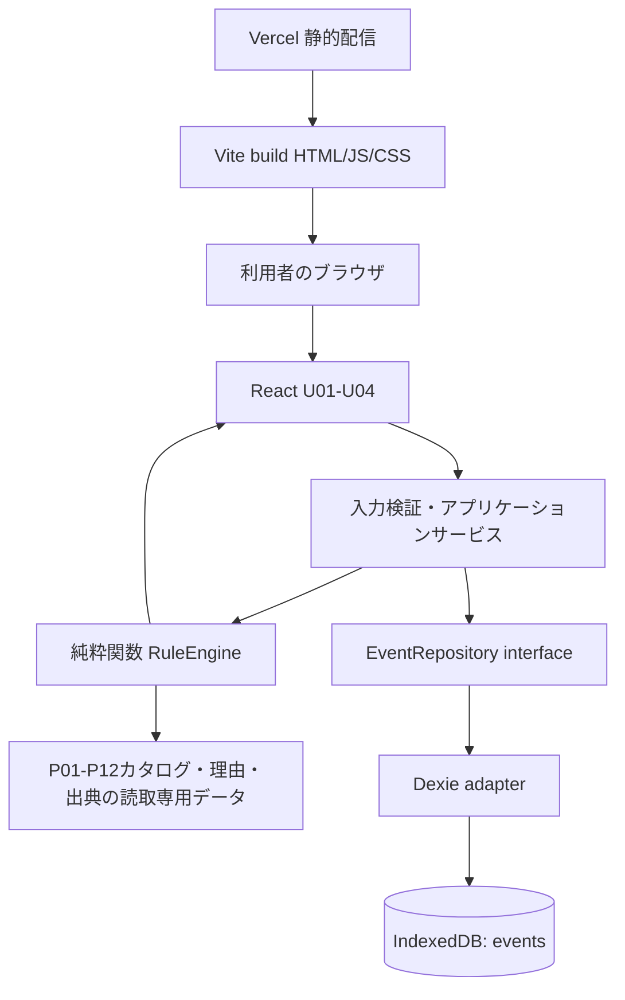

# アーキテクチャ設計書 v1｜採用技術に基づく構成（2026-11-15）

> **React + TypeScript + Vite、IndexedDB + Dexie、Vercelは正式採用。** ルーティング、テスト補助、デザイントークン等は推奨・未決。設計文書のみで、コード／CI／デプロイは作成していない。
> 対象：初めて単発・小規模の地域イベントを主催する個人・小規模チームのための準備全体像・優先順位支援Webアプリ。旧空き家案・物件データモデルは使用しない。

## 1. 全体構成



- **Vercel側**：静的なアプリの配信、GitHub連携、プレビュー。本MVPで利用者の進捗をサーバーに蓄積しない。
- **ブラウザ側**：入力・条件付き質問、ルール計算、画面表示、本人による進捗と保存・削除。
- **オリジン別**：本番・プレビュー・ローカルでIndexedDBは別。データ同期を示唆しない。

## 2. レイヤ別責務（技術仕様）

| レイヤ | 主な責務 | 避けること |
|---|---|---|
| `ui/` | 表示・イベント操作・アクセシビリティ・保存状態表示 | 施設の法規条件や優先度アルゴリズムの直接実装 |
| `features/events/` | U01/U02/U04の入力フロー、ドラフト・確定操作 | ページごとに異なる入力検証 |
| `features/plan/` | U03の優先カード・4領域の一覧・進捗操作 | P1判定をUIコンポーネント内で計算 |
| `domain/validation/` | 入力の型検証、正規化、未定と未回答の区別 | 利用者の値を推測して埋める |
| `domain/rules/` | P01〜P12該当性・優先順位・再確認・理由生成を純粋関数で実装 | DB・現在時刻・外部通信への直接アクセス |
| `domain/catalog/` | タスクID・チェック項目・理由テンプレート・公式出典の適用条件と版 | 自由施設名メモから公的ルールを推定 |
| `application/` | 読込→検証→差分→判定→保存→状態反映を順序制御 | 保存失敗なのに完了として画面遷移 |
| `infrastructure/db/` | Dexie・IndexedDB、CRUD、migration、revision競合検出 | 自動削除・未対応スキーマ無視・削除済みID復活 |

フォルダ名は**提案**。実際のディレクトリ・依存関係は開発前の初回設計レビューで確定する。

## 3. UIとアプリケーションサービスの境界

```text
U01 Home --create--> U02 Basic Input
                     --validate + createEvent()--> IndexedDB
U01 --open(eventId)--> load + validate + calculate --> U03 Plan
U03 --updateProgress(eventId, taskId, status, revision)--> save --> recalculate
U03 --edit--> U04 Edit Draft
U04 --applyChanges(eventId, baseRevision, draft)--> validate
         --> compare + markRecheck --> save --> U03
U04 --cancel--> discardDraft --> U03
U01 --delete(eventId, revision)--> confirm --> delete transaction --> refresh list
```

- 新規作成時はDB保存が成功して初めてU03へ移る。保存失敗はU02の入力を保持。
- U03の進捗変更は自動保存。画面に仮の変更を先に反映する場合も未保存状態を明示。
- U04の編集は保存済みデータと別に保持し、キャンセルで破棄する。
- ブラウザを閉じる・再読込・保存容量・データ削除のあらゆるケースで損失ゼロを保証できるわけではない。
- **U02の初回未完成下書きはA案（永続保存しない）で採用確定**。基本6問の入力状態は画面内のみ。初回保存成功後に初めてイベントレコードを作成。U04のドラフト分離とも整合する。

## 4. データ・状態の更新整合性

- `EventRepository` の操作として `create`, `get`, `list`, `updateIfRevisionMatches`, `deleteIfRevisionMatches` を想定。
- `updateIfRevisionMatches` はIndexedDBのreadwriteトランザクション内で、存在確認・revision照合・更新を一体処理する。失敗時はレコードを変更しない。
- 新規作成APIと更新APIを分離。削除済みeventIdに古いタブから`update`してもupsertせず拒否。
- EventRecordに入力・進捗・版・revisionをまとまりとして保持。表示用の優先順位は原則保存せず再計算。
- スキーマ移行と公式ルール更新の版は別管理。旧タブが新しいschemaを書き壊すことを防ぐ。
- UIは読み取り版と編集中ドラフト版を区別し、異なるイベントのデータを表示・更新しない。

## 5. P01-P12の優先順位生成

1. 入力型の確認と正規化。
2. 公式出典の適用条件確認（高岡市、会場条件、本人の施設カテゴリ選択等）。
3. P01〜P12の該当性・P1/P2/P3の判定。
4. 保存済み進捗（未着手・進行中・完了・対象外）と再確認を合成。
5. 未解決の優先1件＋残りの重要事項＋4領域の全体像を出力。
6. 公式情報は出典・確認日・個別判断ではない旨を別領域に表示。

ルールの細部は [判定契約v1草案](RULE_ENGINE_CONTRACT_V1.md) に一元化。**14日前の推測期限は採用していない**。

## 6. Vercelへの公開構成（実施は後日）

- GitHubの公開ブランチを本番、PR/別ブランチをプレビューの候補として、担当者がアクセス権・公開設定を管理。
- Viteの出力`dist/`相当の静的ファイルを配信。環境変数やAPIキー等はMVPで原則不要。
- SPAの深いパスへのアクセスを設計し、Vercelのrewriteと404・assets配信をE2Eで確認する。
- URL・オリジンが変わるとブラウザ保存領域が変わる。プレビューで作ったテストデータは本番に自動移行しない。
- 本番変更はレビュー済みPR・チェック後に行う。**この文書コミットはアプリをデプロイする操作ではない**。
- Vercelの料金・非商用／チーム条件を公開前に再確認する。

## 7. セキュリティ・プライバシー

- イベントデータは原則ブラウザローカルに保持。外部の分析SDKや外部APIへ本人の入力を送らない設計。
- 入力値は保存前に型検証、出力時は安全なテキストとして表示。HTML埋め込みをしない。
- 公的URLは検証済み台帳から参照。施設メモからURLを生成しない。
- 履歴／オートコンプリート／外部リンク／ログ出力等に個人情報が混入しないか公開前に監査。
- 不要な参加者氏名・連絡先・住所・GPSを収集しない。自由記述に個人情報を書かない案内をする。
- CSP等のHTTPセキュリティヘッダー、依存脆弱性更新、アクセス権設定は運用計画で確認する。

## 8. 障害時の振る舞い

| 故障 | 対応 |
|---|---|
| IndexedDB利用不可 | 「保存不可」を明示、U02/U04の未保存入力を保持 |
| 保存容量不足 | 成功表示をしない。再試行可能な範囲で保持 |
| schemaが未対応／破損 | 読込み停止・上書き禁止・案内 |
| 複数タブで同じイベント更新 | revision競合を検出、後勝ち自動上書きなし |
| 他タブですでに削除 | 更新拒否し、対象不存在を説明 |
| 公式根拠が非該当になった | 古い公式文言を現行プランから除外 |
| Vercelが配信できない | ローカル保存と別問題。**オフライン利用を保証しない** |

## 9. 依存設計の未決事項と品質ゲート

- UIの細部（進捗率、タスクの同時開閉）、型・バリデーションの厳密仕様。**U02下書きの非永続化は決定済み**。
- 判定ルールの依存全パターンと、オンライン開催の支援範囲。
- テスト環境、ルーティング、CSS、データ検証ライブラリ等の正式採用。
- 公開前に保存・復元・移行・削除・公式情報の更新運用をテストし、実装チェックを完了する。

## 10. 公式出典のビルド同梱方式（ADR-012正式採用）

**React/Viteの静的アプリに版付き公式出典カタログを同梱**。施設固有情報は`catalogVersion`・`sourceRevision`・`reviewedMonth`・`baseStatus`と現在のJST暦日、本人が選んだ地域／施設条件から有効性を導出する。期限は[ADR-011](ADR_011_MONTH_END_SOURCE_REVIEW_DEADLINE.md)どおり各月末、翌月1日00:00 JSTから未点検出典の断定を停止。[ADR-012](ADR_012_BUNDLED_OFFICIAL_SOURCE_CATALOG.md)によって別配信JSON／専用APIをMVPでは採用しない。

```text
Git版管理の公式出典台帳 + タスク定義
             ↓ 出典確認・レビュー・Preview点検
        Vite buildId/catalogVersion
             ↓ Vercel静的アプリとして同時配信
ブラウザ：有効状態をJST評価→U03で施設固有案内or一般案内
             ├→ EventRecordの進捗はDexie/IndexedDBに別管理
             └→ 再掲載は最新版ビルドを読み込んだ場合のみ
```

起動時・U03表示・タブ再表示・月境界の再評価を設計。**旧タブへの即時更新保証なし**。最新版検知・未保存U04ドラフト保護・端末時計ずれ対応の具体方式は[STEP7-⑤](STEP7_05_OLD_TAB_UPDATE_CHOICES.md)で比較する。利用者のイベントデータを公式出典側へ送信しない。

## 11. 旧タブの新版検知と手動再読み込み（ADR-013正式採用）

`Vite build`内の`buildId`と**同一オリジンに配信する軽量なbuildIdメタデータのみ**を照合。起動・タブ復帰などの機会に自動確認し、一致しなければ更新案内を表示する。**再読み込みは本人操作のみ、強制リロード禁止**。出典カタログ自体の別JSON取得・専用APIは導入しない（ADR-012維持）。

U02は初回未完成下書きがReactメモリ内だけにあるため、更新時に入力が消えると説明する。U04は未保存ドラフト、U03は進捗自動保存の完了を確認するまで再読み込みしない。buildId取得失敗や不正応答は「新版あり」と推定しない。**月末の出典失効判定はbuildId確認と独立**。通信タイムアウト、キャッシュ、ビルドID生成方式、再確認頻度は開発前の詳細技術検討。[ADR-013](ADR_013_MANUAL_REFRESH_ON_AUTO_VERSION_DETECTION.md)。

## 12. PC・スマホ主要ブラウザの互換性境界（ADR-014採用）

Chrome・Edge・Safari・Firefoxの現行版を**Windows/macOS・Android/iOSで利用可能な組合せに応じて検証**する。実行不可のOS×ブラウザ組合せは必須にしない。具体的な最低対応バージョンは実機検証後に公開前確定。書記素文字数は`Intl.Segmenter('ja',{granularity:'grapheme'})`第一候補でUI・保存で共通計算、IMEはcompositionイベントを中心として候補確定前の強制切断なし。`InputEvent.isComposing`のみへの依存は禁止する技術方針。対応しない環境で暗黙にUTF-16へ変更しない。IndexedDBは同一オリジンのローカル保存でブラウザ間同期・プライベートモード永続保存を保証しない。新ビルド通知はADR-013で本人明示再読込、旧タブDBスキーマ競合は[STEP7-⑥](STEP7_06_SCHEMA_AND_OLD_TAB_SAFETY_REVIEW.md)で検証。**実装・実機試験未実施**。[ADR-014](ADR_014_MAJOR_DESKTOP_MOBILE_BROWSER_SUPPORT.md)。

## 13. JSONバックアップの入出力構成（ADR-015）

U01からエクスポート／インポートを行う。設計上の責務は`ExportService`（保存済みEventRepositoryスナップショット→JSONファイル）と`ImportService`（選択→ローカル検証→件数・衝突プレビュー→明示確定→Dexie保存）に分離。**公式出典の静的カタログをファイルにコピーせず、本人のイベント情報を外部送信しない**。既存イベントの無断上書き・削除・旧空き家データの誤取り込みは禁止。インポートの衝突処理と一括保存方式は別途決定。[ADR-015](ADR_015_JSON_BACKUP_EXPORT_IMPORT.md)。

## 14. JSON復元のコピー衝突処理（ADR-016正式採用）

`ImportService`は全件の形式・内容・ファイル内ID一意性を事前検証し、現在DBとの衝突一覧を**プレビューとして提示**。本人の確定操作後にDexie readwriteトランザクション内で最新のID集合とschema/revisionを再照合し、衝突時は既存レコードを変更せず、バックアップ側を新しい一意eventIdへ割り当てて**新規追加のみ**。衝突分類がプレビュー時から変わった場合はトランザクションを中断し、再プレビューで本人に確認。途中エラーは**全追加をロールバック**して成功と表示しない。既存イベント・U04ドラフト・公式出典カタログを更新しない。複製のrevisionは新規イベントとして扱う。具体的なUUID、timestamp、DBトランザクションの実装パターンは技術レビュー後。[ADR-016](ADR_016_IMPORT_COLLISION_AS_COPY.md)。

## 15. 反復JSON復元の処理境界（ADR-017）

`ImportService`はファイル取込履歴やハッシュDBをMVPに増やさず、**毎回**、検証済みJSONと最新EventRepositoryのID集合からコピー件数・追加件数を算定する。本人確認後に同じトランザクション内で衝突を再照合、変化があれば中断して再承認。衝突したeventIdのデータは一意な新IDのレコードとして追加し、既存には書き込まない。全件成功／全件失敗、未知形式拒否、未保存ドラフト非対象はADR-015/016を維持。[ADR-017](ADR_017_REPEAT_IMPORT_WITH_CONFIRMATION.md)。
