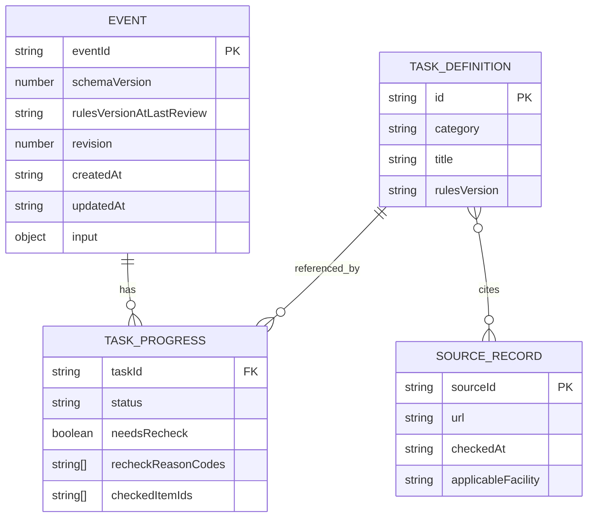

# データ設計書 v1｜イベント保存・進捗・再確認（2026-11-15）

> **技術採用済み**：React + TypeScript + Vite、IndexedDB + Dexie、Vercel。**データ詳細は実装前の仕様草案・未試験**。現行の単発小規模非営利地域イベント準備支援Webアプリ専用。旧空き家所有者／物件／マッチングのDBを継承・移行しない。
> 関連：[ADR-001](ADR_001_TECH_STACK_ADOPTED.md)、[判定契約草案](RULE_ENGINE_CONTRACT_V1.md)、[要件v1草案](REQUIREMENTS_V1_DRAFT.md)。

## 1. 設計方針

- ブラウザ内IndexedDBを唯一の永続的な利用者データ保存先とする。サーバーDB、Auth、他端末との同期なし。
- ユーザー入力とタスク進捗を**イベントごとに分離**。共通タスクと出典はアプリ同梱のバージョン付き読み取り専用データ。
- 保存するのは再計算に必要な**入力と本人の進捗判断**。優先順位や表示カードの生成結果は原則永続化しない。
- **ADR-002採用**：`venueStatus=no_physical_venue`を「オンライン開催」と変換せず保存する。建物専用の子チェックだけ非該当、P07〜P09親は`needs_information`の確認対象とする。旧施設カテゴリは再表示しても現在の根拠として使わない。
- 本番URLとプレビューURLでは保存領域が異なる。別端末やサイトデータ削除で自動復元できない。
- 重要：**TypeScript型検査は読み込んだ保存データの検証を代替しない**。保存時・復元時・移行時にランタイム検証を行う。

## 2. 概念モデル



**物理的なDexieストア数と上の概念モデルは区別**する。MVPの第一案はイベントとイベント別進捗をまとめた単一`events`オブジェクトストア（キー`eventId`、索引`updatedAt`）に保存する。P01〜P12・出典はアプリ同梱。用途が増えたときのみ複数ストアへ正規化する。

## 3. ストア案とキー

| ストア | キー | 内容 | 更新者 |
|---|---|---|---|
| `events` | `eventId` | イベント条件、タスク別進捗、revision、版、タイムスタンプ | アプリのRepository |
| `meta`（任意） | `key` | アプリ全体のストア移行情報、実行済み移行の識別など | Repository／Dexie upgrade |
| `taskCatalog`（アプリ内定数） | `P01`〜`P12` | 準備タスク、条件・文言・依存関係 | Gitで版管理 |
| `officialSources`（アプリ内定数） | `sourceId` | 出典URL、確認日、適用条件 | Gitで版管理 |

## 4. イベントの型契約（概略）

```ts
type Known<T> =
  | { kind: "unanswered" }
  | { kind: "undecided" }
  | { kind: "answered"; value: T };

type EventType = "workshop" | "lecture" | "exchange" | "other";
type Audience = "minors" | "adults" | "both" | "undecided";
type VenueStatus = "undecided" | "candidate" | "confirmed" | "no_physical_venue";
type Region = "takaoka" | "toyama_other" | "outside_toyama" | "undecided";
type OrganizerForm = "solo" | "group" | "undecided";
type DateAnswer =
  | { kind: "date"; value: string }    // YYYY-MM-DD
  | { kind: "month"; value: string }   // YYYY-MM
  | { kind: "undecided" };
type TaskStatus = "not_started" | "in_progress" | "completed" | "not_applicable";
type TaskId = `P${"01"|"02"|"03"|"04"|"05"|"06"|"07"|"08"|"09"|"10"|"11"|"12"}`;

interface EventInput {
  eventType: EventType;
  audience: Audience;
  date: DateAnswer;
  venueStatus: VenueStatus;
  region: Region;
  organizerForm: OrganizerForm;
  attendeeCount: Known<number>; // 1以上の整数。上限は入力仕様で要決定
  responsible: Known<"decided" | "not_decided">;
  equipmentNeed: Known<"yes" | "none_identified">;
  equipmentCategories: string[];
  venueCategory: Known<"takaoka_community_center" | "other">;
  facilityUsersAge: Known<"minors_only" | "includes_adults">;
  venueNameMemo?: string;
  optionalDescription?: string;
}
interface TaskProgress {
  taskId: TaskId;
  status: TaskStatus;
  checkedItemIds: string[];
  needsRecheck: boolean;
  recheckReasonCodes: string[];
  updatedAt: string;
}
interface EventRecord {
  eventId: string;
  schemaVersion: number;
  rulesVersionAtLastReview: string;
  revision: number;
  createdAt: string;
  updatedAt: string;
  input: EventInput;
  progressByTask: Partial<Record<TaskId, TaskProgress>>;
}
```

**このコードは型の検討サンプルであり実装していない。** 「分からない」「まだ未定」は `kind: "undecided"` に正規化し、`kind: "unanswered"` は利用者が回答していない状態に限定する。「特に思いつかない」は `kind: "answered", value: "none_identified"` とし、設備不要の断定とは区別する。施設固有質問は**条件に該当するときだけ**入力と判定を利用する。旧条件の値を保存する場合も最新の計算には使わない。文字列の長さや日時境界・任意メモの最大文字数は要決定。

## 5. 検証条件

- イベント基本6問は選択肢からの値だけを受け付ける。「未定」は明示回答として有効。
- 日付と月は実在する年月日／年月か検証。過去日の扱いは正式未決。日付を入力しただけで許可や締切を確定しない。
- 人数は1以上の安全整数。0、負数、小数、NaN、Infinity、安全整数の範囲外はエラー。**1001人以上はADR-007に従って注意のみ表示し、保存可能**。値だけで公式定員や安全性を判断しない。
- 任意説明と施設名メモは個人情報・HTMLとして解釈せず文字列として表示。文字数は施設名メモ100字、イベント説明500字でADR-008採用済み。文字数のUnicode計測方法と技術的バイト上限は検証事項。
- タスクの`taskId`はP01-P12以外受け付けない。新規未知IDがあれば黙って削除しない。
- `schemaVersion`が未対応の新形式なら**読み取り停止・書き込み防止**。無条件の初期化禁止。

## 6. 主要保存ユースケース

### 新規作成
1. U02の基本6問を検証→新規eventIdを生成。
2. 初期進捗は未着手（生成しただけで完了にしない）。
3. `events`へ新規保存。保存成功後にU03へ。保存失敗時はU02入力を画面に保持し再試行する。
4. **初回入力途中の下書き永続保存はA案で不採用確定（2026-11-15）**。U02の入力は一時的なReact状態のみに保持。途中入力をIndexedDBへ保存したり、未完成イベントをHomeへ追加したりしない。

### U03進捗自動保存
1. 現在のeventIdとrevision、進捗更新案を保持。
2. IndexedDBの**1 readwriteトランザクション**で既存レコードの存在とrevisionを照合、変更を適用しrevisionを増やす。
3. コミット成功で「このブラウザに保存しました」。失敗なら未保存変更とエラーを表示。
4. 別タブで変更済みなら競合を表示。自動上書きしない。

### U04編集・反映
1. 元の保存版と分離したドラフトを編集。「キャンセル」はドラフトだけ破棄。
2. 「変更を反映」で検証→影響タスクの再確認→プラン再計算→イベントと進捗変更の保存を1トランザクションで確定。
3. 保存成功後だけU03へ戻る。失敗時は元の保存版と編集ドラフトを区別して保持する。

### 個別削除
1. 対象イベントを確認ダイアログで特定してから削除。
2. 保存済み`eventId`の存在とrevisionを照合して削除。
3. 削除成功後だけ一覧から消す。**旧タブからのupsertを禁止**し、古いeventIdのデータを復活させない。
4. ほかのイベントやタスク共通定義には触れない。

## 7. 版管理と移行

- **DBスキーマ版**：Dexieの`version(...).stores(...)`と必要なupgrade手順で移行。移行に失敗した場合のトランザクションロールバックを試験する。**既存データを無断削除しない**。
- **ルール版**：P01-P12の判定条件・理由の版。版変更では旧完了履歴は保持し、新ルールでの再確認を計算。
- **出典版**：施設公式情報のURL・確認日・適用範囲を管理。過去の適用先から別施設へ勝手に転用しない。
- 移行前に対応版・形式検証を行い、移行後も検証。読み取り途中で例外なら利用者に復旧不能な初期化を促さない。
- データのエクスポート・インポート、クラウドバックアップはMVP対象外。将来的な設計余地は確保する。

## 8. 異常系とセキュリティ

| 条件 | 必須動作 |
|---|---|
| IndexedDB使用不可・容量超過 | 保存失敗を表示。保存済みと偽らず、操作中の入力を保持 |
| schema破損／未対応 | 読込停止、エラー案内、既存の保存データを上書きしない |
| 別タブから更新 | revision差分を検出し、無条件上書きを防ぐ |
| 他タブですでに削除 | 該当recordなしとして更新拒否 |
| サイトデータ削除 | 復元を保証できない旨を事前に説明 |
| プレビューURLから本番へ | オリジンが異なるためデータ移行しない |
| 施設カテゴリ変更 | 古い施設根拠・適用条件を現在の結果から除外 |
| 自由記述の悪意あるHTML | DOMへHTMLとして挿入せずテキスト表示 |

## 9. テスト・未決事項

テスト対象：作成→2件分離→進捗更新→再読込→削除／旧タブ復活防止／revision競合／移行失敗／容量超過／不正な日付／未回答と未定／条件付き施設データ。

**確定**：初回下書きは永続保存しない。**未決**：入力値の一部の型の正規化、Unicode計測・技術的バイト上限、進捗率と対象外の集計、公式情報更新ルール、旧形式の具体的移行経路。すべて実装前に決定・テスト計画化する。

## 10. 進捗・再確認の操作スキーマ補足（2026-11-15提案）

[STEP6-① 進捗・再確認仕様](STEP6_01_PROGRESS_RECHECK_SPEC.md)を参照。本人の`status=not_applicable`とルールエンジンの`applicability=no`は別軸で保存・計算する。`completed+needsRecheck`または`not_applicable+needsRecheck`を許容し、条件変更時は旧進捗を黙って書き換えない。

**ADR-004正式採用**：本人が「再確認を終えた」を明示選択した場合だけ、revision照合付きトランザクションで`needsRecheck=false`、現在の`recheckReasonCodes=[]`を保存。`progress.status`を変更しない。保存前に「解除済み」と表示しない。理由コードの全履歴保持方法はMVP範囲外／未決。

**入力検証案**：[STEP6-②](STEP6_02_VALIDATION_CONTRACT.md)に基本6問・任意回答の判別状態・ランタイム検証を整理。人数上限、メモ文字数上限、過去日入力、条件外施設値の保存／クリアは未承認の設計事項。

## 11. 再確認解除のRepository更新境界（ADR-004正式採用）

操作契約：`clearRecheck(eventId, taskId, expectedRevision)`。同一IndexedDB readwriteトランザクション内でレコード存在、revision一致、taskIdの妥当性、現在のneedsRecheckを確認し、対象タスクのstatusとcheckedItemIdsを保持したままneedsRecheckをfalse、現在のrecheckReasonCodesを空配列に更新する。成功後のみ新revisionと保存成功状態を返す。競合、保存失敗、削除済みIDなら既存保存レコードを変更せず、上書き・復活をしない。これは**API設計であってコード実装ではない**。

## 12. 施設固有入力の非該当クリア（ADR-005正式採用）

[ADR-005](ADR_005_CLEAR_INAPPLICABLE_FACILITY_INPUT.md)により**確定保存成功時のみ施設固有入力を削除**する。U04のドラフトの地域・会場状態から施設情報の適用可否を導出し、非該当なら`venueCategory`／`facilityUsersAge`を`{kind:"unanswered"}`に正規化、`venueNameMemo`を空欄にする。ただし高岡市の候補/確定のまま施設カテゴリだけ`other`等になった場合、現在の候補施設のメモは本人の入力として保持し、センター固有の`facilityUsersAge`のみクリア。**既存の旧入力はトランザクション成功前には変更せず、再読込・古いタブ・保存失敗で上書きしない。** 進捗、子チェック履歴、他イベントは削除対象ではない。

`EventInput`スキーマの任意`venueNameMemo`は現在の本人が選ぶ施設のメモを意味し、**施設変更を自動検知できる識別子はまだない**。本人が同じ会場状態のまま別施設に変える場合の再確認・メモ更新導線は追加レビュー対象。設計の実際のクリア対象、復元禁止、例外テストはADR-005を参照。

## 13. 日付の保持・過去時期の注意（ADR-006正式採用）

`EventInput.date`は`{kind:"date",value:"YYYY-MM-DD"}`、`{kind:"month",value:"YYYY-MM"}`、`{kind:"undecided"}`をそのまま保存する。過去日を未来へ修正せず、月を日へ変換しない。ローカル暦日を基準に過去の**実在日・月を警告付きで許容**。警告は保存用の期限や完了ステータスではなく表示用の導出値。U04で過去日を含むイベントを再編集しても自動的に保存をブロックしない。詳細は[ADR-006](ADR_006_ALLOW_PAST_SCHEDULE.md)。

## 14. 任意参加人数B案（ADR-007正式採用）

`attendeeCount`は`{kind:unanswered}`／`{kind:undecided}`／`{kind:answered,value:number}`。回答済みの場合は`Number.isSafeInteger(value) && value>=1`を必須とする。1001以上は**入力バリデーションエラーでなく表示上の注意**を導出し、値の保存、再編集、イベント復元を許容。通常の`EventRecord`には注意フラグを恒久保存せず、読み込み時の現在の値から計算する。データ上限と小規模イベントの行政定義を混同しない。正式決定：[ADR-007](ADR_007_ATTENDEE_COUNT_WARNING.md)。

## 15. 任意メモの文字数と永続化（ADR-008正式採用）

`venueNameMemo`は100字、`optionalDescription`は500字まで、どちらも任意。上限を超えるU04ドラフトは保存せず、以前のEventRecordとrevisionを維持する。保存時・読込時のランタイム検証も同じ文字数定義を使用。警告や残り字数はイベント本体に冗長保存しない。Unicodeの書記素クラスタ（`Intl.Segmenter`）を第一候補とし、IME中は強制切断しない。長い結合文字を別途防御するサイズ上限は**技術レビュー未決**。ADR-005により不適用の施設名メモはU04確定保存成功時のみ消去。[ADR-008](ADR_008_OPTIONAL_TEXT_LIMITS.md)。

## 16. 出典有効状態の月末境界（ADR-011正式採用）

ユーザーの`EventRecord`（IndexedDB）には**出典の確認予定日をユーザーごとに複製しない**。公式出典の版付きカタログ（アプリ同梱、保存される本人進捗とは別）に`sourceId`、`sourceRevision`、`baseStatus`、`checkedAt`、`reviewedAt`、`reviewedMonth`（YYYY-MM）などを保持する**設計案**。期限ルールは**JST各暦月末日中に当月レビュー完了、未完了のまま翌月1日00:00から当該出典の断定停止**で正式決定。現在の基準日時と出典データから`effectiveStatus`を算出し、`verified`の保存値だけを信用しない。未記録・破損の出典は一般確認へフォールバック。出典の失効によって`progressByTask`のstatusやイベントのrevisionを無条件に書き換えない。出典モデルの物理保存形式・旧タブの更新通知は未決。[ADR-011](ADR_011_MONTH_END_SOURCE_REVIEW_DEADLINE.md)。

## 17. 静的公式出典カタログのデータ境界（ADR-012採用）

`SourceCatalog`はイベントデータのIndexedDBと分離し、Git管理の`catalogVersion,buildId,sourceId,sourceRevision,baseStatus,checkedAt,reviewedAt,reviewedMonth,facilityScope,applicabilityPredicate,officialUrl`などをViteビルドへ読み取り専用同梱する設計。**原ページを再確認したことが古いタブへ自動反映されると扱わない**。新しい`verified`情報の復帰は新版ビルドの読込後、本人の施設条件との一致とJST月末期限判定が揃った場合だけ。古いイベントの`progress.status`は出典の失効のみで変更しない。出典の改定による`needsRecheck`は影響範囲に限定。技術上の型・物理保存形式と版ID生成は未承認。決定：[ADR-012](ADR_012_BUNDLED_OFFICIAL_SOURCE_CATALOG.md)。

## 18. ブラウザ別保存と文字数の技術境界（ADR-014）

正式に検証するブラウザはPC・スマホの主要現行Chrome/Edge/Safari/Firefox（OSで実行可能な組合せ）。EventRecordは**同一オリジン・同一ブラウザのIndexedDB**に保存し、他ブラウザ・他端末への同期を行わない。プライベートモード、ストレージ消去、容量制限、ブラウザ更新時の読込失敗に注意。任意文字列100／500字のカウンターと検証は**同じ書記素計算**を第一候補に、保存時にも計数単位を統一。非対応時に無言でUTF-16へ切替えない。旧タブによる未知schemaVersion書込・revision競合を阻止する実装方式は技術レビュー待ち。[ADR-014](ADR_014_MAJOR_DESKTOP_MOBILE_BROWSER_SUPPORT.md)。

## 19. JSONバックアップのデータ設計（ADR-015）

**エクスポート＋インポートをMVPに採用**。対象は保存成功済みEventRecord。JSONルートの提案は`formatId,exportSchemaVersion,exportedAt,sourceBuildId,eventCount,events`。入力・progressByTask・再確認・イベント版を保存し、公式出典／再計算可能な優先度は含めない。

取り込みは**メモリ上で全件をサイズ・形式・既知schema・イベントID・必須6問・人数・100/500字・進捗状態・タスクIDまで検証**し、件数とID衝突を表示して本人が確定するまでDBに書かない。未知形式・旧空き家JSONは拒否。保存失敗・別タブ競合で既存レコードを保護。ファイルサイズ・旧版対応範囲・重複ID処理・バッチトランザクション詳細は未決。[ADR-015](ADR_015_JSON_BACKUP_EXPORT_IMPORT.md)。

## 20. インポート時の別ID複製・revision・原子的保存（ADR-016正式採用）

バックアップ内のeventIdが**既存DBのIDと衝突した場合は新たに一意eventIdを発行し、別イベントとして新規追加**。既存DBのeventId・入力・進捗・revision・日時を**変更しない**。衝突しないイベントは元IDを維持して新規追加。ファイル内eventId重複は全件取込み拒否。本人の完了・対象外・要再確認と入力を複製するが、優先度・該当性・公式出典は現在のビルドで再計算。複製後のrevisionは**新しい独立EventRecordの初期revision**であり、元IDのrevisionをコピーして一続きの履歴とみなさない（初期値1は技術候補）。元の日時・コピー元IDを内部記録に保持するかは別途データ仕様を確定する。

**検証→プレビュー→明示確定**までは書き込まず、確定時に同一Dexie readwriteトランザクション内で現行ID・schema・revisionを再検査し、衝突分類がプレビューから変化した場合は**変更後のプレビューと本人再承認**が必要。全件を新規追加できた場合のみコミット成功。保存失敗や他タブ競合では部分追加を行わず既存イベントも維持。反復インポートではコピー増加を事前に説明。正本：[ADR-016](ADR_016_IMPORT_COLLISION_AS_COPY.md)。

## 21. 繰り返しインポートのデータ境界（ADR-017正式採用）

同一JSONの繰返し復元を**ブロックしない**。ファイル内容のハッシュ・インポート履歴の追加テーブルはMVPでは保持しない。**毎回**、現在のIndexedDBイベントID集合との衝突を評価し、追加・別IDコピーの件数と既存件数をプレビュー。本人の明示確定前は保存なし。衝突時の新しい一意eventId、独立revisionと本人の進捗・再確認の保持はADR-016に準拠。プレビュー後に衝突分類が変わった場合は再承認。一括失敗時は部分追加も既存変更もなし。元日時・新しいrevision初期値・コピーの由来表示は未決。[ADR-017](ADR_017_REPEAT_IMPORT_WITH_CONFIRMATION.md)。

## 22. 復元した新規レコードの日時と由来（ADR-018正式採用）

**全インポート新規イベントのrevisionは1**（同一ID衝突の有無を問わない）。新しいEventRecordの`createdAt=updatedAt=importedAt`は**一括復元の確定保存時刻**とする。バックアップ元の`revision`は現DBのCAS/競合判定に流用しない。既存イベントのイベントID／revision／日時／進捗は一切変更しない。

新規レコードの`importedFrom`は**直接の元**`originalEventId`、`originalCreatedAt`、`originalUpdatedAt`、`importedAt`を記録。復元元JSONに過去の由来欄があっても無限の履歴配列として継承しない。元の日時が不正なら捏造・暗黙補正をしない。詳細：[ADR-018](ADR_018_RESTORED_EVENT_REVISION_AND_PROVENANCE.md)。由来の元revisionの保持、具体的なISO日時検証、異常な未来日時の取扱いは未決。

U01は復元イベントに「バックアップから復元」、衝突に伴う追加コピーには「別コピー」を表示する設計。開催日Q3とバックアップ元の作成日、復元日のそれぞれの意味を混同しない。

## 23. JSONバックアップ1ファイルの件数・実バイト上限（ADR-019）

**正式上限：2 MiB（2,097,152 UTF-8バイト）かつ100イベントまで**。書出し側は、保存済みEventRecordの一貫したスナップショットからJSONを完成させ、**ルートメタデータ、エスケープ、importedFromを含む最終的なUTF-8バイト長**を算定する。両上限内の場合だけ全件をバックアップとして生成。インポート側は選択ファイルの物理バイト数を先に検査、形式・eventCount一致・100件上限・スキーマ・進捗・ID整合を検証してから本人へプレビュー。片方の上限だけ満たしても拒否。**無断で一部を除外せず、失敗時は元DB不変**。分割方式は[STEP7-⑯](STEP7_16_EXPORT_SPLIT_OPTIONS.md)で選択待ち。既存の100/500字書記素上限とファイル容量は別。[ADR-019](ADR_019_JSON_BACKUP_LIMIT_2MIB_100_EVENTS.md)。
