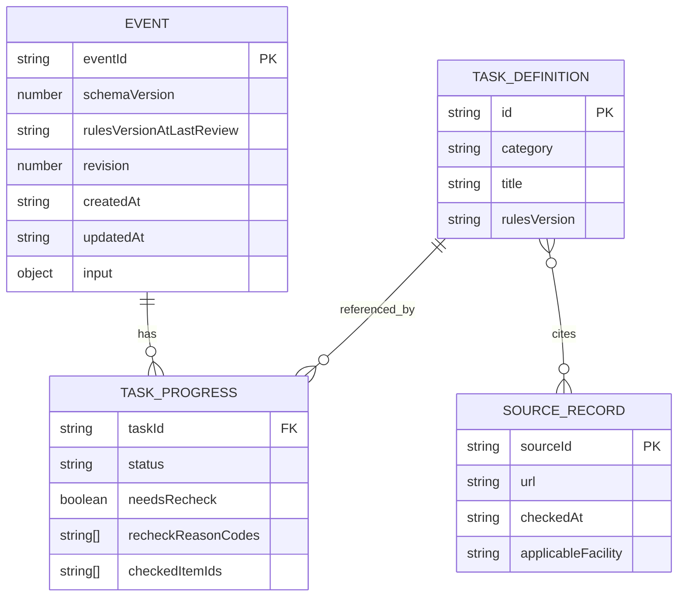

# データ設計書 v1｜イベント保存・進捗・再確認（2026-11-15）

> **技術採用済み**：React + TypeScript + Vite、IndexedDB + Dexie、Vercel。**データ詳細は実装前の仕様草案・未試験**。現行の単発小規模非営利地域イベント準備支援Webアプリ専用。旧空き家所有者／物件／マッチングのDBを継承・移行しない。
> 関連：[ADR-001](ADR_001_TECH_STACK_ADOPTED.md)、[判定契約草案](RULE_ENGINE_CONTRACT_V1.md)、[要件v1草案](REQUIREMENTS_V1_DRAFT.md)。

## 1. 設計方針

- ブラウザ内IndexedDBを唯一の永続的な利用者データ保存先とする。サーバーDB、Auth、他端末との同期なし。
- ユーザー入力とタスク進捗を**イベントごとに分離**。共通タスクと出典はアプリ同梱のバージョン付き読み取り専用データ。
- 保存するのは再計算に必要な**入力と本人の進捗判断**。優先順位や表示カードの生成結果は原則永続化しない。
- **ADR-002採用**：`venueStatus=no_physical_venue`を「オンライン開催」と変換せず保存する。建物専用の子チェックだけ非該当、P07〜P09親は`needs_information`の確認対象とする。旧施設カテゴリは再表示しても現在の根拠として使わない。
- 本番URLとプレビューURLでは保存領域が異なる。別端末やサイトデータ削除で自動復元できない。
- 重要：**TypeScript型検査は読み込んだ保存データの検証を代替しない**。保存時・復元時・移行時にランタイム検証を行う。

## 2. 概念モデル



**物理的なDexieストア数と上の概念モデルは区別**する。MVPの第一案はイベントとイベント別進捗をまとめた単一`events`オブジェクトストア（キー`eventId`、索引`updatedAt`）に保存する。P01〜P12・出典はアプリ同梱。用途が増えたときのみ複数ストアへ正規化する。

## 3. ストア案とキー

| ストア | キー | 内容 | 更新者 |
|---|---|---|---|
| `events` | `eventId` | イベント条件、タスク別進捗、revision、版、タイムスタンプ | アプリのRepository |
| `meta`（任意） | `key` | アプリ全体のストア移行情報、実行済み移行の識別など | Repository／Dexie upgrade |
| `taskCatalog`（アプリ内定数） | `P01`〜`P12` | 準備タスク、条件・文言・依存関係 | Gitで版管理 |
| `officialSources`（アプリ内定数） | `sourceId` | 出典URL、確認日、適用条件 | Gitで版管理 |

## 4. イベントの型契約（概略）

```ts
type Known<T> =
  | { kind: "unanswered" }
  | { kind: "undecided" }
  | { kind: "answered"; value: T };

type EventType = "workshop" | "lecture" | "exchange" | "other";
type Audience = "minors" | "adults" | "both" | "undecided";
type VenueStatus = "undecided" | "candidate" | "confirmed" | "no_physical_venue";
type Region = "takaoka" | "toyama_other" | "outside_toyama" | "undecided";
type OrganizerForm = "solo" | "group" | "undecided";
type DateAnswer =
  | { kind: "date"; value: string }    // YYYY-MM-DD
  | { kind: "month"; value: string }   // YYYY-MM
  | { kind: "undecided" };
type TaskStatus = "not_started" | "in_progress" | "completed" | "not_applicable";
type TaskId = `P${"01"|"02"|"03"|"04"|"05"|"06"|"07"|"08"|"09"|"10"|"11"|"12"}`;

interface EventInput {
  eventType: EventType;
  audience: Audience;
  date: DateAnswer;
  venueStatus: VenueStatus;
  region: Region;
  organizerForm: OrganizerForm;
  attendeeCount: Known<number>; // 1以上の整数。上限は入力仕様で要決定
  responsible: Known<"decided" | "not_decided">;
  equipmentNeed: Known<"yes" | "none_identified">;
  equipmentCategories: string[];
  venueCategory: Known<"takaoka_community_center" | "other">;
  facilityUsersAge: Known<"minors_only" | "includes_adults">;
  venueNameMemo?: string;
  optionalDescription?: string;
}
interface TaskProgress {
  taskId: TaskId;
  status: TaskStatus;
  checkedItemIds: string[];
  needsRecheck: boolean;
  recheckReasonCodes: string[];
  updatedAt: string;
}
interface EventRecord {
  eventId: string;
  schemaVersion: number;
  rulesVersionAtLastReview: string;
  revision: number;
  createdAt: string;
  updatedAt: string;
  input: EventInput;
  progressByTask: Partial<Record<TaskId, TaskProgress>>;
}
```

**このコードは型の検討サンプルであり実装していない。** 「分からない」「まだ未定」は `kind: "undecided"` に正規化し、`kind: "unanswered"` は利用者が回答していない状態に限定する。「特に思いつかない」は `kind: "answered", value: "none_identified"` とし、設備不要の断定とは区別する。施設固有質問は**条件に該当するときだけ**入力と判定を利用する。旧条件の値を保存する場合も最新の計算には使わない。文字列の長さや日時境界・任意メモの最大文字数は要決定。

## 5. 検証条件

- イベント基本6問は選択肢からの値だけを受け付ける。「未定」は明示回答として有効。
- 日付と月は実在する年月日／年月か検証。過去日の扱いは正式未決。日付を入力しただけで許可や締切を確定しない。
- 人数は1以上の整数。0、負数、小数、NaN、極端に大きい値は未承認の上限に従ってエラーまたは確認。
- 任意説明と施設名メモは個人情報・HTMLとして解釈せず文字列として表示。文字数上限は未決。
- タスクの`taskId`はP01-P12以外受け付けない。新規未知IDがあれば黙って削除しない。
- `schemaVersion`が未対応の新形式なら**読み取り停止・書き込み防止**。無条件の初期化禁止。

## 6. 主要保存ユースケース

### 新規作成
1. U02の基本6問を検証→新規eventIdを生成。
2. 初期進捗は未着手（生成しただけで完了にしない）。
3. `events`へ新規保存。保存成功後にU03へ。保存失敗時はU02入力を画面に保持し再試行する。
4. **初回入力途中の下書き永続保存はA案で不採用確定（2026-11-15）**。U02の入力は一時的なReact状態のみに保持。途中入力をIndexedDBへ保存したり、未完成イベントをHomeへ追加したりしない。

### U03進捗自動保存
1. 現在のeventIdとrevision、進捗更新案を保持。
2. IndexedDBの**1 readwriteトランザクション**で既存レコードの存在とrevisionを照合、変更を適用しrevisionを増やす。
3. コミット成功で「このブラウザに保存しました」。失敗なら未保存変更とエラーを表示。
4. 別タブで変更済みなら競合を表示。自動上書きしない。

### U04編集・反映
1. 元の保存版と分離したドラフトを編集。「キャンセル」はドラフトだけ破棄。
2. 「変更を反映」で検証→影響タスクの再確認→プラン再計算→イベントと進捗変更の保存を1トランザクションで確定。
3. 保存成功後だけU03へ戻る。失敗時は元の保存版と編集ドラフトを区別して保持する。

### 個別削除
1. 対象イベントを確認ダイアログで特定してから削除。
2. 保存済み`eventId`の存在とrevisionを照合して削除。
3. 削除成功後だけ一覧から消す。**旧タブからのupsertを禁止**し、古いeventIdのデータを復活させない。
4. ほかのイベントやタスク共通定義には触れない。

## 7. 版管理と移行

- **DBスキーマ版**：Dexieの`version(...).stores(...)`と必要なupgrade手順で移行。移行に失敗した場合のトランザクションロールバックを試験する。**既存データを無断削除しない**。
- **ルール版**：P01-P12の判定条件・理由の版。版変更では旧完了履歴は保持し、新ルールでの再確認を計算。
- **出典版**：施設公式情報のURL・確認日・適用範囲を管理。過去の適用先から別施設へ勝手に転用しない。
- 移行前に対応版・形式検証を行い、移行後も検証。読み取り途中で例外なら利用者に復旧不能な初期化を促さない。
- データのエクスポート・インポート、クラウドバックアップはMVP対象外。将来的な設計余地は確保する。

## 8. 異常系とセキュリティ

| 条件 | 必須動作 |
|---|---|
| IndexedDB使用不可・容量超過 | 保存失敗を表示。保存済みと偽らず、操作中の入力を保持 |
| schema破損／未対応 | 読込停止、エラー案内、既存の保存データを上書きしない |
| 別タブから更新 | revision差分を検出し、無条件上書きを防ぐ |
| 他タブですでに削除 | 該当recordなしとして更新拒否 |
| サイトデータ削除 | 復元を保証できない旨を事前に説明 |
| プレビューURLから本番へ | オリジンが異なるためデータ移行しない |
| 施設カテゴリ変更 | 古い施設根拠・適用条件を現在の結果から除外 |
| 自由記述の悪意あるHTML | DOMへHTMLとして挿入せずテキスト表示 |

## 9. テスト・未決事項

テスト対象：作成→2件分離→進捗更新→再読込→削除／旧タブ復活防止／revision競合／移行失敗／容量超過／不正な日付／未回答と未定／条件付き施設データ。

**確定**：初回下書きは永続保存しない。**未決**：入力値の一部の型の正規化、長さ上限、進捗率と対象外の集計、公式情報更新ルール、旧形式の具体的移行経路。すべて実装前に決定・テスト計画化する。

## 10. 進捗・再確認の操作スキーマ補足（2026-11-15提案）

[STEP6-① 進捗・再確認仕様](STEP6_01_PROGRESS_RECHECK_SPEC.md)を参照。本人の`status=not_applicable`とルールエンジンの`applicability=no`は別軸で保存・計算する。`completed+needsRecheck`または`not_applicable+needsRecheck`を許容し、条件変更時は旧進捗を黙って書き換えない。

**ADR-004正式採用**：本人が「再確認を終えた」を明示選択した場合だけ、revision照合付きトランザクションで`needsRecheck=false`、現在の`recheckReasonCodes=[]`を保存。`progress.status`を変更しない。保存前に「解除済み」と表示しない。理由コードの全履歴保持方法はMVP範囲外／未決。

**入力検証案**：[STEP6-②](STEP6_02_VALIDATION_CONTRACT.md)に基本6問・任意回答の判別状態・ランタイム検証を整理。人数上限、メモ文字数上限、過去日入力、条件外施設値の保存／クリアは未承認の設計事項。

## 11. 再確認解除のRepository更新境界（ADR-004正式採用）

操作契約：`clearRecheck(eventId, taskId, expectedRevision)`。同一IndexedDB readwriteトランザクション内でレコード存在、revision一致、taskIdの妥当性、現在のneedsRecheckを確認し、対象タスクのstatusとcheckedItemIdsを保持したままneedsRecheckをfalse、現在のrecheckReasonCodesを空配列に更新する。成功後のみ新revisionと保存成功状態を返す。競合、保存失敗、削除済みIDなら既存保存レコードを変更せず、上書き・復活をしない。これは**API設計であってコード実装ではない**。
