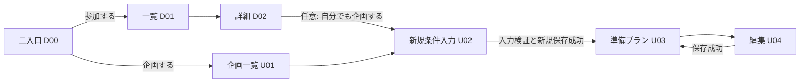
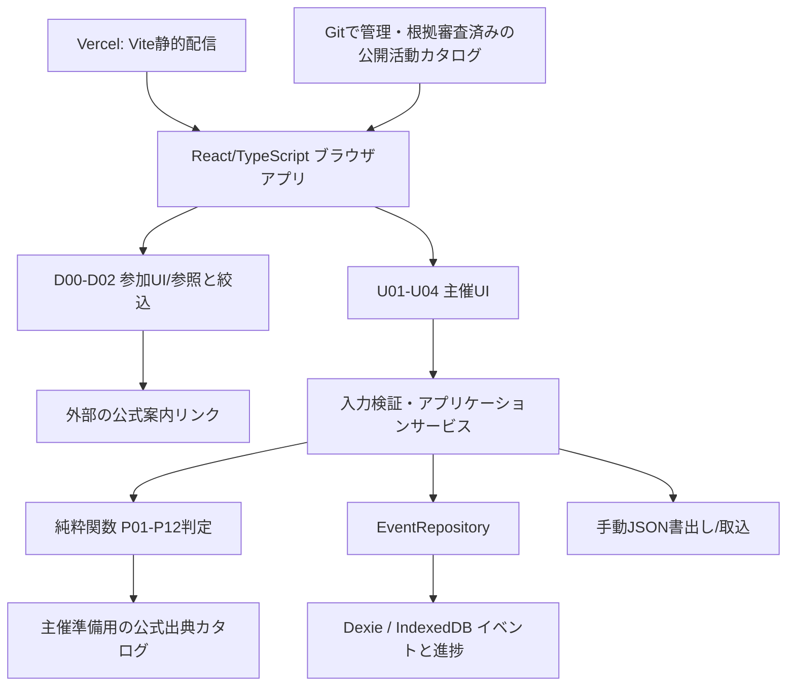

# 二入口の画面・検索・アーキテクチャ整合性レビュー（2026-11-21）

> **設計補足・実装前**。本書は新しいADRではない。既存の正式決定（ADR-001、ADR-030〜032等）を上書きせず、参加したい人・初めて主催する人の2ペルソナに対する実装受入を具体化する。コード、実行試験、掲載承認、公開は未実施。

## 1. D00〜D02：画面ごとの最小責務

| 画面 | 必須体験 | 不要/禁止 |
|---|---|---|
| D00 | 「参加してみたい」→D01、「自分で企画したい」→U01。どちらからも開始できる | 参加履歴の必須化、属性/年齢入力 |
| D01 | 掲載承認済み活動を表示し、`municipality`と`topicTag`で絞り込む。0件なら明示して公的・運営元索引を案内 | 未承認活動の混入、日時・料金・年齢の新規フィルターを既決扱い |
| D02 | タイトル・運営者・地域・開催の情報、対象/費用/申込条件などを根拠付きで示し、確認日と公式URLと優先された次の一歩1件を表示 | 不明=無料/歓迎/受付中という推測、残席保証、アプリ内申込 |

D01のカードは、実在する個別の公式活動を別担当がレビューし`visible`になったときだけ掲載する。索引サイトは個別イベントと区別。初期公開時に`visible=0`の場合、架空データで埋めず公式索引導線へ縮退する。

### 参加判断を助けるD02情報の扱い

| 情報 | 画面上での扱い |
|---|---|
| 日時/場所/所要時間 | 一次情報の確認内容。未記載は「確認できていません」 |
| 対象年齢/参加条件 | 記載された条件のみ。利用者の資格を判定しない |
| 費用/申込方法/持ち物 | 未記載は「無料」「申込不要」「持ち物なし」にしない |
| 初参加歓迎/一人参加可否 | 運営元が明記した場合のみ表記 |
| 募集状態 | 確認時点の事実と現在の参加可否を分離。受付中・残席保証なし |
| 出典/確認日 | 公式元URLと最後の確認時点を見つけやすく表示 |
| 次の一歩 | STEP11-③の`ENDED→CLOSED→VERIFY_STATUS→VERIFY_REQUIREMENTS→READ_OFFICIAL_GUIDE→READ_SOURCE`順で一件 |

`confirmed`、`unknown`、`not_applicable`を混同しない。具体的な型・enumは先行契約に従いレビュー中として扱う。最新の掲載候補を自動的に`visible`へ昇格させない。

## 2. 参加から企画への接続

- D02→U02時は新規空入力。参加中の活動名/場所/対象/日時を自動転記しない。
- U02の初回下書きは画面内のみ。保存成功前にU03へ移動しない。
- U01からの既存イベント再開はD00を強制しない。D01絞込は同一閲覧セッション中の戻りで保持する設計ケースがある。
- 主催P01〜P12の優先度・理由・本人進捗・再確認・revision CAS・JSONバックアップを変更しない。

## 3. 論理アーキテクチャ（既存ARCHITECTURE_V1の二入口補足）

- **データ境界**：公開参加活動`activityId`と利用者の主催`eventId`は別系統。参加カタログは静的・読み取り専用、個人のEventRecordは端末内保存。参加閲覧や参加履歴をIndexedDB/JSONに追加しない。
- **配信境界**：Vercelはアプリ・審査済み公開情報を配信。主催個人データはサーバーに送信しない。主催イベントを自動的に公開カタログへ載せることはできない。
- **更新境界**：活動の募集鮮度は参加側で別管理。主催施設出典の月末レビュー規則を「現在受付中」の保証として使わない。旧タブ即時更新も保証しない。
- **セキュリティ**：公式URLは根拠台帳の値のみ。個人連絡先を掲載しない。利用者の年齢・プロフィール・参加履歴・位置情報を収集しない。

## 4. 受入確認シナリオ（すべて not_run）

| ID | 操作・状態 | 期待結果 |
|---|---|---|
| UX-P01 | D00から参加、地域・活動分野で絞る | 確認済み個別活動のみが一致し、空なら0件 |
| UX-P02 | D02の費用が根拠不明 | 「無料」と断定しない |
| UX-P03 | D02の一人参加・初参加歓迎が不明 | 「歓迎」「安心」と断定しない |
| UX-P04 | 公式ページ上で受付終了を確認 | 終了/募集終了の扱いを優先し、受付中扱いしない |
| UX-P05 | D02→U02 | 空の既定6問で開始、参加データ・履歴の転記なし |
| UX-P06 | D00→U01→U02 | 参加せずに主催を開始できる |
| UX-P07 | 参加側カタログが新しいビルドで更新 | 既存EventRecordのrevision/進捗/JSONへ影響なし |
| UX-P08 | 掲載承認済み個別活動0件 | 架空イベントを作らず公式索引へ |
| UX-P09 | U02で保存失敗 | 入力保持・成功を表示せずU03へ進まない |
| UX-P10 | U03で既存の親タスクを更新 | 親タスクだけをCAS保存し子チェックを作らない |

## 5. 発表・応募に使う説明（仮説、未実証）

- **課題**：地域活動を「探して参加する」と「自分で企画する」のどちらでも、最初の行動が見えにくい。
- **体験**：参加側は条件と公式情報・次の一歩を確認。主催側は基本6問からP01〜P12の条件別優先順位・理由を得る。二つを任意の導線でつなぐ。
- **差別化仮説**：一覧掲載だけではなく参加の判断材料を明確化し、初主催の準備支援へ連続させる。ただし既存類似サービス比較で独自性を実証する必要がある。
- **技術的工夫**：静的参加カタログとローカル主催EventRecordの境界、根拠とunknownの区別、純粋関数による説明可能な条件判定、revision CAS/JSONの安全な保存。
- **未達・未検証**：利用者ヒアリング、実イベント掲載の二人目承認、実装、ブラウザ動作、コンテスト提出。デモ時には机上サンプルと本当の掲載活動を混同しない。

## 6. 次の人間レビューのゲート

1. 利用者候補へのインタビューで「必要な参加条件」「初主催の準備順序」の仮説を検証。
2. #14/#15/#17のタグ/市町村enum、掲載責任・更新/停止・URL照合、実掲載の二人目レビューを実施。
3. 現在の機能別作業パッケージと担当を照合し、D01/D02・U02/U03の受入シナリオを実装Issueにひも付ける。
4. 実装・実行テスト・デプロイは別途の明示許可まで行わない。

参照：[ペルソナと体験](PERSONAS_AND_PARTICIPATION_TO_ORGANIZATION_JOURNEY_20261121.md)／[ADR-030](ADR_030_TOYAMA_PARTICIPATE_AND_ORGANIZE_MVP_SCOPE_ADOPTED.md)／[STEP11-③](STEP11_03_PARTICIPATION_PUBLISHING_AND_NEXT_ACTION_CONTRACT_20261118.md)／[STEP15](STEP15_PARTICIPATION_CATALOG_EVIDENCE_WORKFLOW_20261119.md)／[アーキテクチャ](ARCHITECTURE_V1.md)。
