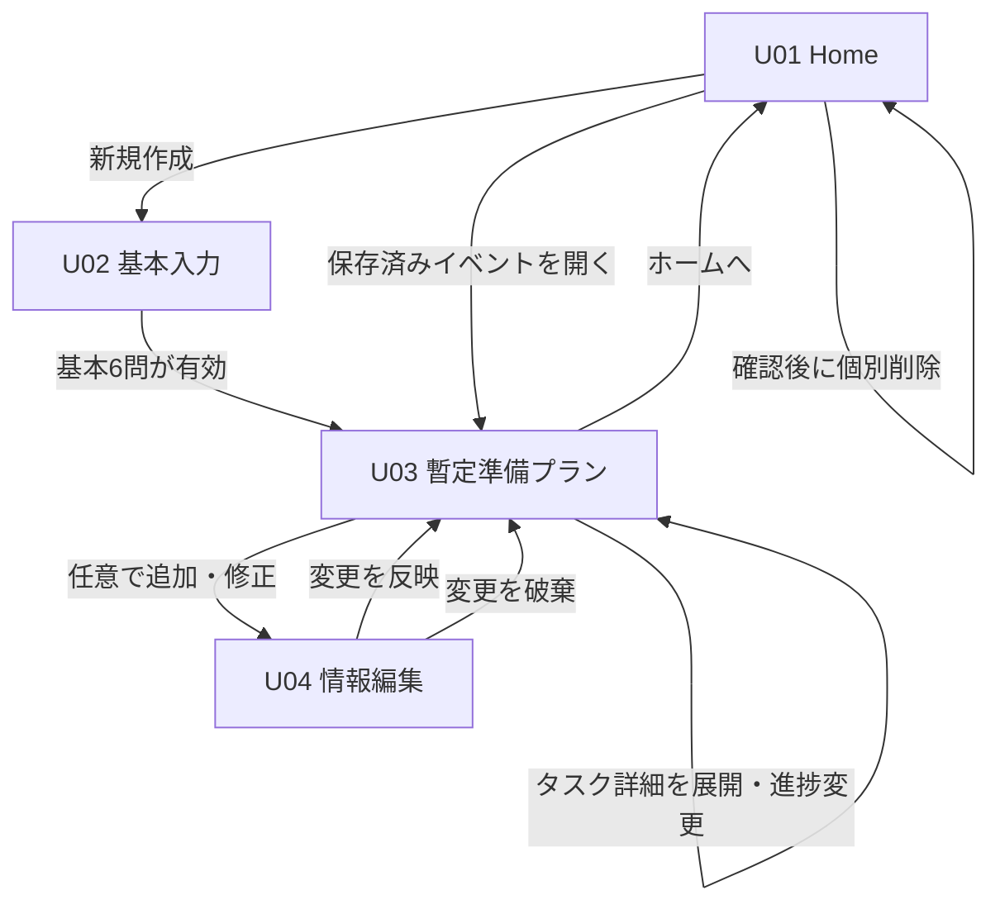

# STEP 5｜現行MVPの画面設計 v0.1（2026-11-14）

> **適用対象**：富山県プログラミングコンテスト作品部門、初めて単発・小規模の非営利地域イベントを主催する個人・小規模チームのための「準備の全体像と優先順位」支援Webアプリ。
>
> **設計案（未実装・未ユーザーテスト）**。採用済みのMVP境界は [STEP4-⑫要件定義](STEP4_12_MVP_REQUIREMENTS_V01.md)、入力選択肢は [STEP3](STEP3_MVP_BOUNDARY.md)、タスクの基礎は [STEP4判定表](STEP4_INPUT_OUTPUT_EVIDENCE.md)。旧「空き家活用・所有者向け診断・物件マッチング」や、旧「本人の困りごとを入力→相談文コピー」フローは本MVPに含めない。
>
> 古い [STEP5_USER_EXPERIENCE.md](STEP5_USER_EXPERIENCE.md) と [USER_FLOW.md](USER_FLOW.md) の画面・設問案は履歴資料。**現行の画面設計の参照は本書を優先**する。確定済みの要件を上書きする新機能の採用は行わない。

## 1. UX設計原則

1. **初回で価値を早く見せる**：基本6問から暫定プランへ。任意の詳細入力は結果後に促す。
2. **「優先→次の行動→全体像」を主役に**：優先カード1件が表示されても他の重要確認を隠さない。
3. **事実・提案・公式根拠の分離**：入力から分かること／一般的な準備提案／特定施設の公式条件を区別する。
4. **未回答・未定・未着手・対象外・完了は別物**。会場決定は予約承認と同義ではない。
5. **進捗は任意・保存は見える**：ログイン不要、同じブラウザで複数イベントを再開可能。ブラウザ保存はバックアップではない。
6. **不安を増やさない文面**：優先度は危険認定や許可判断ではない。利用者に判断を押し付けない。
7. **機能を増やさない**：予約・申請・参加者管理・相談文コピー・空き家診断・マッチング・クラウド同期は初期MVP外。

## 2. 画面一覧・遷移

| ID | 画面 | 主な役割 | 主操作 |
| --- | --- | --- | --- |
| U01 | Home / イベント一覧 | 新規作成、既存イベント再開、個別削除、保存注意 | 「新しいイベントを作る」またはイベントカードを開く |
| U02 | Event Setup / 基本入力 | 基本6問＋必要な条件付き確認。暫定プラン生成 | 「準備プランを見る」 |
| U03 | Preparation Plan / 準備プラン | 優先事項→次の行動→4領域12タスク→根拠、タスク詳細展開、進捗変更 | タスクの進捗を変更／必要なら「情報を追加・編集」 |
| U04 | Event Edit / 情報編集 | 基本条件変更、任意詳細化、再計算の前提を確認 | 「変更を反映してプランへ」 |

- 初回で保存データがない場合、U01には大きな「イベントを作成」を表示し、空の一覧を強調しない。
- 保存済みイベントがある場合、カードは「イベント種類／対象／時期／保存状態・最終更新」を中心にし、生成日時と更新日時を混同しない。
- 存在しないIDの直接URLは「イベントが見つからない」を表示し、U01へ戻す。
- 未保存変更がある場合は画面切替時に保存試行し、失敗時には安全に残る範囲を説明して選択肢を出す。ブラウザ終了時の保存成功は保証しない。

## 3. U01 Home

### 表示
- 見出し「地域イベントの準備を、整理しよう。」、説明「準備の全体像と、今優先したいことが分かります」。
- 主CTA「新しいイベントを作る」。
- 既存イベントがあれば一覧。各カード：本人が入力したイベント名称がなければイベント種類を仮タイトルとして表示、参加対象、予定時期（未定なら未定）、更新日時、再開リンク。**イベント名を必須入力へ増やさない**。
- 進捗の「4/12完了」のような表示は、非該当や再確認を含む分母定義が確定するまでは採用しない。
- 各カードの削除は二次操作（メニュー等）に置き、確認ダイアログでイベントを特定して削除。確認前に実行しない。
- サイトデータ削除・別ブラウザ・プライベートブラウズで失われる可能性を設定/説明リンクから確認可能にする。

### 状態
- 0件：説明と新規CTA。
- 1件以上：新規CTAと保存イベント一覧。カードの並びは原則最終更新の降順、同時刻なら安定ID順。
- 読み込み中：不明な保存済み件数を0件と断定しない。
- 読込失敗／未対応版：データを初期化せず、再試行と説明を表示。新規作成可否はデータ破損の種類に応じて決める（上書きしない）。
- 削除失敗：対象カードを勝手に一覧から消さない。

## 4. U02 基本6問（順番・表示）

| 順序 | 項目 | 選択肢・入力 | 例外 |
| --- | --- | --- | --- |
| 1 | イベント種類 | 体験会・ワークショップ／勉強会・講座／交流会・意見交換会／その他 | 自由説明は後で任意追加 |
| 2 | 参加対象 | 子ども・未成年／大人／両方／未定 | 主催者の年齢と混同しない |
| 3 | 開催希望時期 | 日付／年月／未定 | 日付選択時のみ日付、月選択時のみ年月 |
| 4 | 会場の状況 | 未定／候補あり・未確定／場所確定（本人申告）／物理会場なし | 確定でも予約許可を断定しない |
| 5 | 開催地域 | 高岡市／県内その他／県外／未定 | 市町村特有条件は高岡市のみ |
| 6 | 主催者の形態 | 一人／複数人／未定 | 責任者決定を推測しない |

- 必要な6問に答えたら暫定プラン生成へ。未定は正規の選択肢として許容。
- 施設候補があり/場所確定＋地域が高岡市の場合、該当する施設カテゴリの条件付き入力を挿入し、地域交流センターを本人が明示した場合のみ利用者の年齢構成を確認する（公式の適用条件の誤提示を防ぐ）。施設名は任意メモで、判定に利用しない。
- 条件に該当しない確認は非表示にし、以前の値が存在しても判定対象とせず、将来条件が戻った時のデータ保持方針は状態設計で確定する。
- 無効日付、過去日などは「希望時期を確認してください」と項目近傍で明示。過去日をどう扱うかは最終バリデーションで決定する。未知の施設利用期限を算出しない。
- プランを初めて生成する前の編集中の自動保存は、確定済みイベントと混同させず「下書き」にするかを別途決める。**下書き復元は現時点で未決定**。

## 5. U03 準備プラン（中心画面）

表示順の推奨：
1. イベントのコンパクトな概要（種別・対象・時期・会場条件）と「情報を編集」。
2. **今優先する確認**：代表タスク1件。表示項目＝タスク名、優先理由、今できる具体行動、必要な確認先／未確定情報。P1が複数なら残りのP1も必ず近接表示。
3. **準備の全体像**：4領域（企画／運営／会場／募集・開催前）のP01〜P12。該当しないタスクは対象外であることを説明して折りたたみ。
4. **進捗更新**：各タスクで「未着手／進行中／完了／対象外」。生成直後は利用者の完了を推測しない。対象外の重要確認は理由・注意を表示。
5. **タスク詳細**：行を展開すると、何を確かめるか、具体的な確認項目、前提、出典付き公式情報、進捗、再確認理由を表示。独立ページは不要とする案。
6. **保存状態**：「保存中」「このブラウザに保存済み」「保存できませんでした」を区別。画面に保存成功を偽って表示しない。
7. **説明リンク**：地域の公式情報は出典、対象、確認日、個別の利用承認ではない旨を示す。

優先タスクが完了・対象外・再確認中に変わった場合は最新の有効な未解決事項から代表を選ぶ。すべて解決した場合も未確認の法的可否を勝手に保証せず、次に確認が必要なものがない状態と区別する。

### 進捗と再確認
- 進捗：未着手、進行中、完了、対象外。再確認フラグは別。
- 「完了＋再確認が必要」の場合、完了履歴は表示するが「確認済みとして解決」とは扱わない。
- 条件変更時の対象外タスクは適用外であることと、利用者が手動で「対象外」に設定したことを区別する。
- 細かな確認項目は任意チェック。全部チェックしただけで親タスクを自動完了させない。
- 同優先度のタスクは固定順。優先度は危険認定・公的期限の断定ではない。

## 6. U04 情報編集

- 先頭でイベント概要を見せ、基本6問と任意詳細（人数、責任者決定、設備の必要性と種類、内容説明）を変更できる。
- 施設カテゴリと該当する年齢構成の質問はU02と同じ適用条件。画面によってルールを変えない。
- 変更前後の差分からプランを再計算し、会場・対象変更など関連タスクにのみ「再確認が必要」を付ける。無関係な完了履歴は保持。
- 保存/反映の主操作は「変更を反映する」。キャンセルは今回の編集差分を破棄し、既存の保存済み状態へ戻る。
- 変更反映中に保存が失敗した場合は未保存の状態と再試行を示す。画面内メモリ上で再計算しただけでは永続化成功とみなさない。
- 会場「物理会場なし」のオンライン支援は未確定。物理施設用の注意を適用せず、未対応範囲を明示する。

## 7. 共通UI状態と文言

| 状態 | 表示例 | 禁止する挙動 |
| --- | --- | --- |
| 未保存の変更 | 「変更があります」 | 保存済みと表示 |
| 保存処理中 | 「保存中…」 | 保存完了と断定 |
| 保存成功 | 「このブラウザに保存しました」 | クラウドバックアップを示唆 |
| 保存失敗 | 「保存できませんでした。変更はこの画面に残っています」＋再試行 | 自動で画面を閉じてデータ消失 |
| 複数タブ競合 | 「別のタブで変更されました」＋再読込/比較の導線 | 古い値で無条件上書き |
| 破損/未対応版 | 「保存内容を開けません」＋再試行と説明 | 黙って初期化 |
| 公式情報該当なし | 「該当する公式案内は未登録です」 | 推測URLや架空期限の生成 |
| 削除確認 | イベントの識別と「元に戻せません」 | 1クリックで不可逆削除 |
| 記録なし | 「まだイベントはありません」＋新規CTA | エラーのように見せる |
| 完了＋再確認 | 「以前は完了／条件変更のため再確認」 | 完全に解決済みとみなす |

## 8. レスポンシブ・アクセシビリティ仕様

- PC：本文最大幅を設け、優先タスクを上部、4領域は一覧/セクション表示。過剰な2カラムで理由と次の行動を離さない。
- スマホ：1カラム。優先カードを最初に、次の行動を同じまとまりに表示。カード内操作に横スクロールを要求しない。
- 最小320px幅、200%文字拡大、キーボード操作、ラベルとエラーの関連付け、意味を色だけで伝えないことをテスト対象とする。
- タスク展開はボタンで操作、状態はテキストでも表現。削除確認後は戻り先へフォーカスを適切に移す。
- 入力エラーは該当項目に近接表示し、回答済み項目を消さない。
- 保存の状態更新は過剰な読み上げが発生しない方法を選ぶ（実装時に確認）。
- モーションは必須にせず、操作の成否をアニメーションのみに依存させない。

## 9. 机上のシナリオ（実行テストではない）

| ID | シナリオ | 期待画面 |
| --- | --- | --- |
| UX-01 | 初回・イベントなし | U01の新規作成CTA、空の一覧を強調しない |
| UX-02 | 基本6問・子ども向け体験会 | U03に安全確認P05、会場状況に応じたタスク、理由 |
| UX-03 | 会場決定済み | U03で会場の再探索を強制せずP08確認は残す |
| UX-04 | 高岡市地域交流センターを本人が明示 | 施設固有の根拠カード。利用可否を断定しない |
| UX-05 | 県内その他・県外 | 高岡市施設固有条件を表示しない |
| UX-06 | 進捗を完了に変更 | U03で未解決優先事項と保存状態が更新 |
| UX-07 | 会場を変更 | U04→U03で関連完了タスクに再確認フラグ |
| UX-08 | 保存済みイベントを再開 | U01→U03でそのイベントのみ復元 |
| UX-09 | 複数イベント保存・1件削除 | 削除したものだけ一覧から消える |
| UX-10 | 保存失敗／容量不足 | 未保存表示、再試行、データ消失の可能性を説明 |
| UX-11 | 複数タブ・破損データ | 無条件の上書き・初期化なし |
| UX-12 | キーボード・小画面・文字拡大 | 入力、展開、状態更新、削除確認が可能 |

## 10. 残る設計判断・次工程

1. **STEP5次の詳細化**：U01〜U04の実寸ワイヤーフレーム、各ボタン文言と配置、入力分割、保存エラーと再確認の操作設計。
2. 初回の**未完成下書き**を自動保存・復元するか。複数イベントの名称・並び・進捗分母の計算方式。
3. P01〜P12の適用・優先・待機・再確認について、既存STEP4判定表の提案と2026-11-14の会話を単一の実装契約に統合。
4. 保存API・バージョン移行・競合処理、対応ブラウザ、公式情報の更新運用を決める。
5. 要件定義v1確定→技術選定書→データ設計・アーキテクチャ・テスト・開発運用計画へ。**コード着手は別途指示後**。

## 11. 旧案とAI利用の記録

旧空き家活用プロダクト由来の物件、所有者、6用途診断、場所タイプ選択、マッチング、地図中心UI、旧「困りごと→相談文」動線は取り込まない。ChatGPTを現行のGitHub仕様照合、画面構成と状態・受け入れ観点の文書化に使用した。実利用者の需要、画面の使いやすさ、アプリの動作は未検証。
